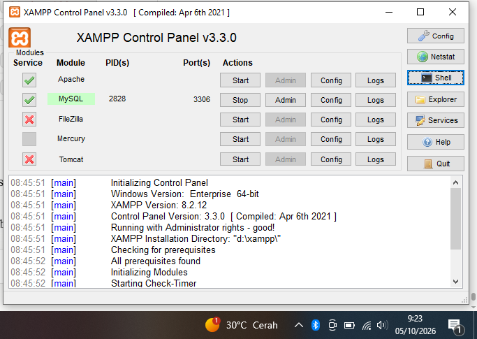
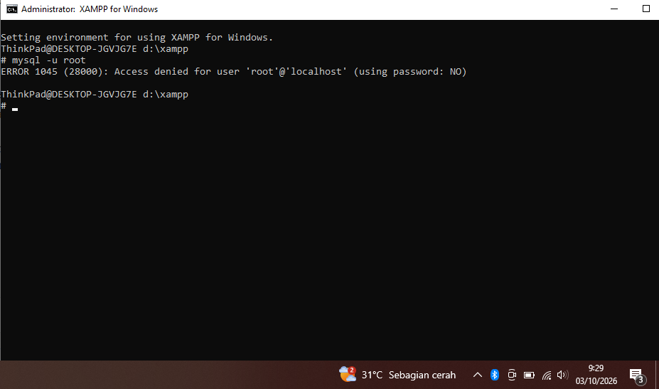
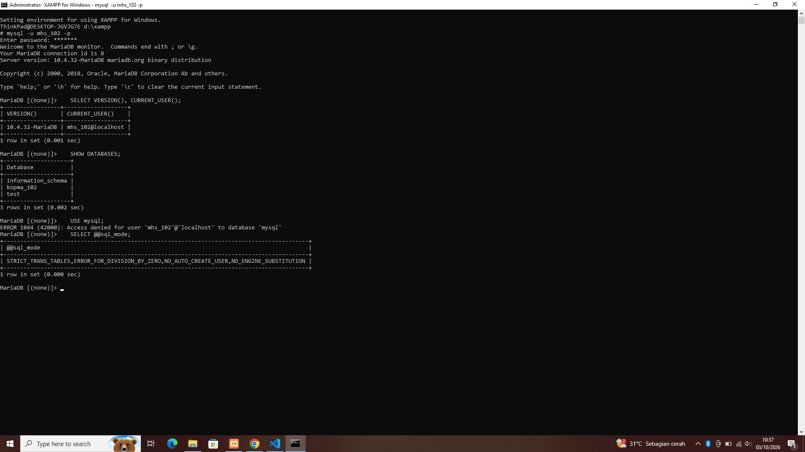
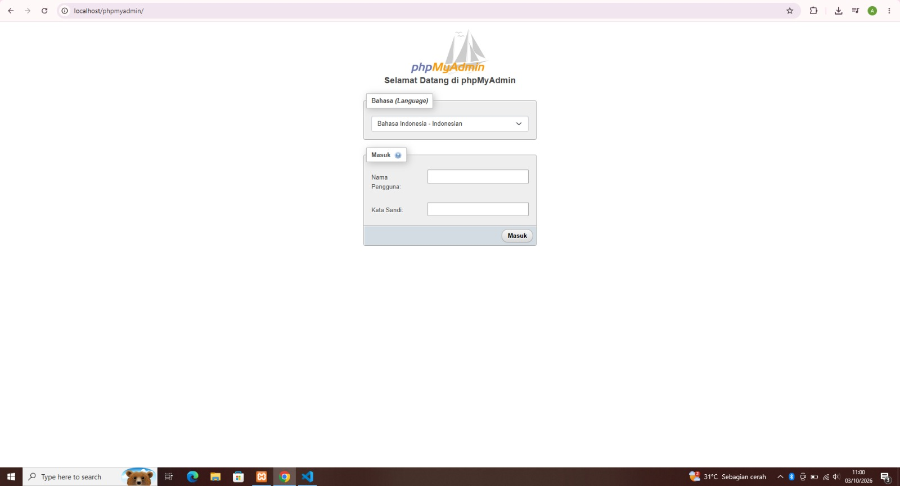
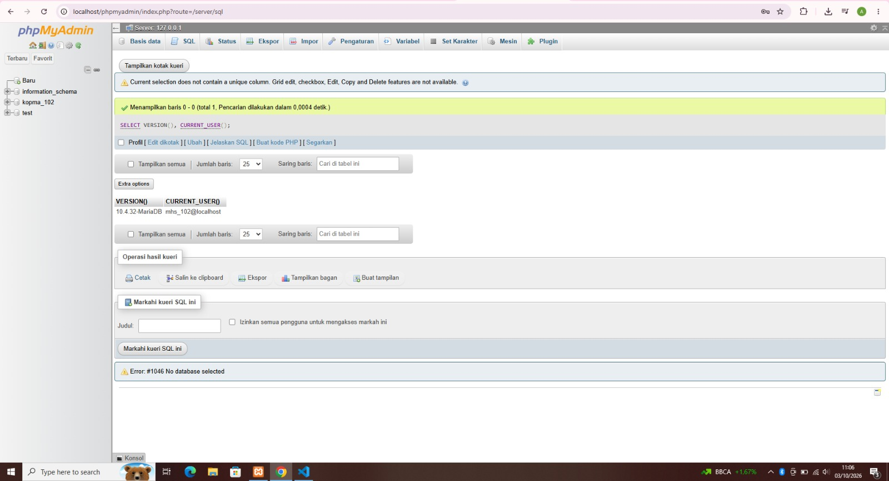
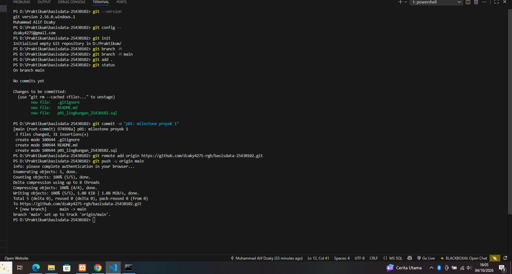
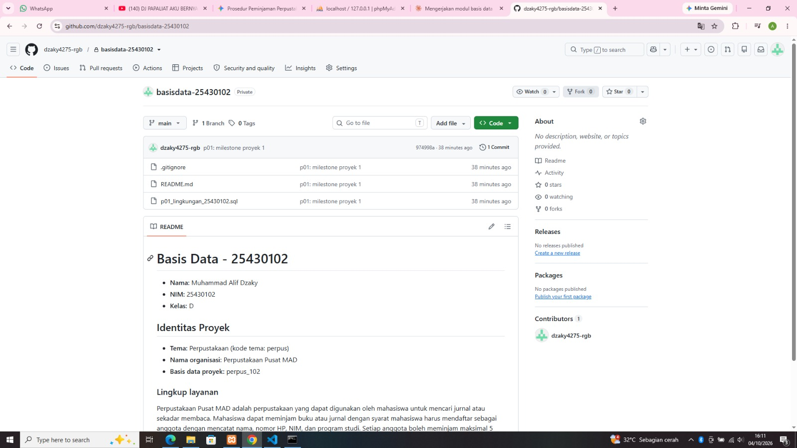
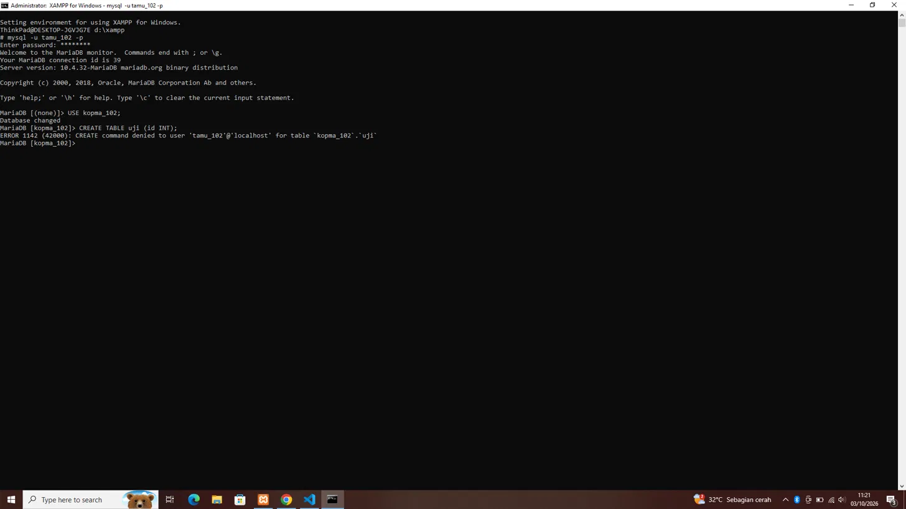
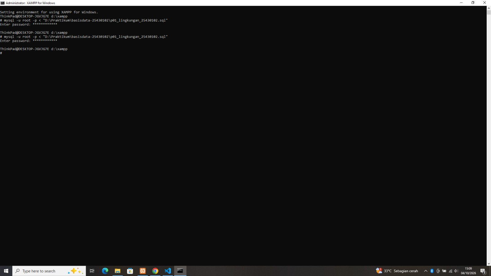
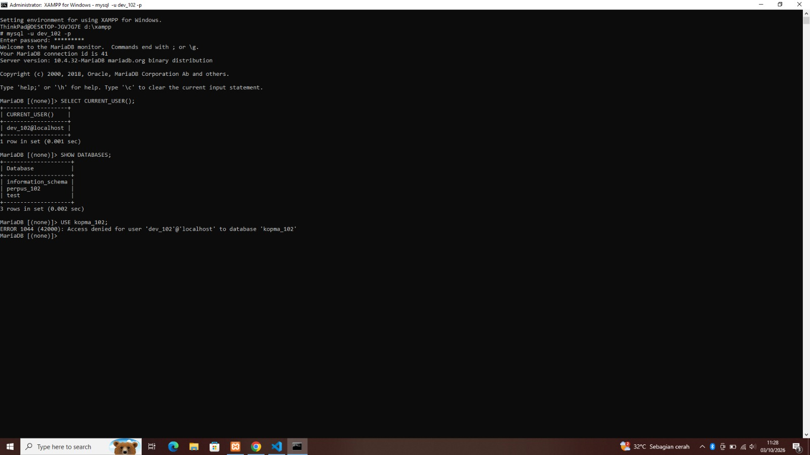

# Laporan Praktikum Basis Data - Pertemuan 01

**Nama:** Muhammad Alif Dzaky     **NIM:** 25430102      **Kelas:** D    **Tanggal:** 3 Oktober 2026      **Dosen Pengampu** Dedi Irawan, S.Kom., M.T.I.     

## 1. Tujuan Praktikum
Pada praktikum ini saya belajar menyalakan server MariaDB lewat XAMPP dan membaca statusnya. Saya juga belajar masuk ke server lewat CLI dan phpMyAdmin, lalu mengamankan akun root dan membuat akun kerja yang haknya terbatas. Terakhir, saya membuat basis data pertama dan mencatat pekerjaan ke Git lalu mengirimnya ke GitHub.

## 2. Ringkasan Dasar Teori
MariaDB bekerja dengan pola klien-server. Server berjalan terus di port 3306, sedangkan klien seperti mysql dan phpMyAdmin mengirim perintah lalu menerima hasil atau pesan galat. Kalau pesan galat diawali kode ERROR, berarti koneksi sudah berhasil dan serverlah yang menolak perintah.

Akun di MariaDB ditentukan oleh pasangan nama dan host, misalnya mhs_102@localhost. Praktikum ini memakai prinsip hak akses minimum: root hanya untuk administrasi, sedangkan pekerjaan harian memakai akun yang hanya berhak atas satu basis data. Git dipakai untuk mencatat setiap perubahan berkas sebagai commit, supaya proses pengerjaan bisa dibuktikan.

## 3. Hasil Langkah Percobaan
### D.1 Menjalankan MariaDB

Keterangan: Pada gambar, modul MySQL bersetatus hijau dan berjalan di port 3306. Artinya server MariaDB sedang berjalan dan siap menerima koneksi dari klien, seperti klien mysql atau php MyAdmin melalui port tersebut

### D.3 Mengamankan akun root

Keterangan: saat masuk root tanpa -p, muncul EROR 1045 dengan tulisan using password: NO. Artinya klien tidak mengirim passsword. Berbeda dengan using password: YES, yang berarti password dikirim tetapi password tersebut salah.

### D.4 Akun kerja mhs_102

Keterangan: Akun mhs_102 hanya bisa melihat basis data information_schema_kopma_102 dan test.Ketika mencoba USE mysql; muncul EROR 1044 karena akun ini tidak memiliki hak akses ke basis data mysql. Hal ini sesuai dengan prinsip hak akses minimum (least priviliege), yaitu akun kerja hanya diberikan hak yang diperlukan pada basis data tertentu

### D.5 phpMyAdmin mode cookie

Keterangan: Setelah auth_type diubah menjadi cookie, phpMyAdmin menampilkan halaman login saat dibuka. Setelah login sebagai mhs_102, hasil kueri menunjukkan pengguna mhs_102@localhost. Mode cookie dipilih karena lebih aman, sebab password tidak disimpan langsung di dalam berkas konfigurasi seperti pada mode config.

### D.6 Git dan GitHub

Keterangan: Pada gambar terlihat hash commit 974998a dengan pesan p01: milestone proyek 1, tiga berkas yang dicatat ( gitignore, README.md, dan p01_lingkungan_25430102.sq ), dan hasil push ke GitHub. Git digunakan untuk mencatat, melacak, dan menyimpan perubahan berkas praktikum secara bertahap sehingga pekerjaan dapat dibuktikan dan dikirim ke repositori.

## 4. Jawaban Titik Analisis
**Titik Analisis 1**
(TA.1 Server pada screenshot menyebut dirinya MariaDB 10.4.32, sesuai dengan tulisan Server version dan hasil VERSION(). Karena MariaDB dan MySQL adalah produk basis data yang berbeda, solusi yang ditemukan dengan kata kunci “MySQL” belum tentu cocok dengan MariaDB 10.4.32. MariaDB punya banyak perintah dasar yang kompatibel dengan MySQL, seperti SELECT, CREATE USER, dan GRANT, tetapi fitur tertentu dapat berbeda antarversi. Contohnya, buku menyebut fitur MariaDB versi baru seperti INSERT ... RETURNING dan JSON_TABLE yang sengaja tidak dipakai dalam praktikum karena lingkungan yang dipakai adalah MariaDB 10.4.32. Oleh karena itu, dokumentasi MySQL cukup digunakan untuk memahami perintah dasar yang kompatibel, sedangkan untuk hal yang bergantung pada versi, sebaiknya memakai dokumentasi MariaDB yang sesuai dengan versinya.)

**Titik Analisis 2**
(TA.2 Pesan ERROR 1045 (28000): Access denied for user 'root'@'localhost' (using password: NO) terdiri dari ERROR 1045 sebagai kode galat, 28000 sebagai SQLSTATE, dan Access denied for user ... sebagai teks penjelasan. Bagian using password: NO memberi tahu bahwa klien tidak mengirim password, sedangkan using password: YES berarti password dikirim tetapi salah. Pembagian ini sesuai dengan Gambar 1.10 pada buku, yang menjelaskan bahwa pesan ERROR 1045 dibaca berdasarkan  dan frasa using password: NO/YES menjadi petunjuk penting.)

**Titik Analisis 3**
(TA.3 information_schema tetap terlihat oleh mhs_102 karena basis data tersebut berisi informasi metadata tentang objek-objek basis data yang dapat dilihat oleh pengguna, dan informasi yang ditampilkan disesuaikan dengan hak akses pengguna. Sebaliknya, mysql berisi data internal server dan daftar hak akses semua akun, sehingga mhs_102 tidak punya izin untuk mengaksesnya dan ketika menjalankan USE mysql; muncul ERROR 1044. ERROR 1044 menunjukkan bahwa akun tidak berhak mengakses suatu basis data, sedangkan ERROR 1045 terjadi pada saat autentikasi ketika pengguna gagal masuk karena password tidak dikirim atau salah.)

**Titik Analisis 4**
(TA.4 Mode cookie lebih aman karena password tidak disimpan langsung di config.inc.php, tetapi diminta saat pengguna melakukan login, sehingga password tidak ikut tersimpan dalam berkas konfigurasi yang dapat dibaca atau tersalin oleh pihak lain. Jika menggunakan mode config, password yang tersimpan di berkas dapat ikut terbawa ketika berkas disalin atau bahkan tidak sengaja di-commit ke Git, sehingga dapat membocorkan password. Hal ini sejalan dengan penggunaan .gitignore dan aturan jangan commit password, yaitu menjaga agar informasi autentikasi tidak disimpan atau disebarkan melalui berkas proyek. Di mode config, siapa pun yang membuka http://localhost/phpmyadmin langsung masuk tanpa login, dan itu yang terjadi sebelum kamu mengubahnya.
)
## 5. Hasil Latihan dan Modifikasi
### E1 Akun tamu_102

Keterangan: USE kopma_102 berhasil karena tamu_102 memiliki hak SELECT pada basis data tersebut, tetapi CREATE TABLE ditolak karena akun tidak memiliki hak membuat tabel. ERROR 1142 menunjukkan tidak adanya hak pada perintah tertentu, sedangkan 1044 menunjukkan tidak berhak mengakses basis data dan 1045 menunjukkan masalah autentikasi password. ERROR 1045 terjadi saat login, sedangkan 1044 dan 1142 terjadi setelah login berhasil.

### E2 Skrip yang bisa dijalankan ulang

Keterangan: IF NOT EXISTS memastikan objek hanya dibuat jika belum ada, sehingga skrip dapat dijalankan kembali tanpa menghasilkan galat karena objek yang sudah tersedia. Buktinya, skrip dijalankan dua kali berturut-turut dan keduanya selesai tanpa galat.

## 6. Tugas Mandiri: Milestone Proyek 01

Keterangan: Bukti pemisahan dev_102 dari kopma_102 adalah dev_102 hanya diberikan hak pada basis data proyek perpus_102. SHOW DATABASES untuk akun ini hanya menampilkan information_schema, perpus_102, dan test, lalu USE kopma_102; menghasilkan ERROR 1044. Dengan begitu hak akses kedua lingkungan terpisah.

## 7. Pembahasan dan Kendala
**Kendala 1: Perintah SQL diketik di prompt Windows.** Saat mengetik SELECT VERSION(), CURRENT_USER();, muncul pesan SELECT is not recognized as an internal or external command. Pesan ini berasal dari Windows, bukan dari MariaDB, karena perintah diketik di prompt d:\xampp dan belum berada di dalam MariaDB. Saya mengatasinya dengan mengetik mysql -u root -p dulu sampai prompt berubah menjadi MariaDB [(none)]>, baru mengetik perintah SQL.

**Kendala 2: Salah ketik password.** Login dengan mysql -u root -p dan mysql -u tamu_102 -p sempat gagal dengan ERROR 1045 (using password: YES). Artinya password terkirim tetapi tidak cocok. Penyebabnya salah ketik di kolom password yang tidak menampilkan huruf, terlihat dari jumlah bintang yang kurang satu. Saya mengulang login dengan mengetik lebih teliti, dan berhasil.

**Kendala 3: sql_mode belum ketat.** Hasil SELECT @@sql_mode; tidak memuat STRICT_TRANS_TABLES. Akibatnya data yang tidak valid bisa disimpan dengan peringatan saja, tidak ditolak. Saya mengganti baris sql_mode di my.ini (folder D:\xampp\mysql\bin), lalu Stop dan Start ulang MySQL. Setelah itu STRICT_TRANS_TABLES muncul.

**Kendala 4: Lupa titik koma dan salah ketik.** Perintah SHOW DATABES; menghasilkan ERROR 1064 (kesalahan sintaks) karena huruf A hilang. Pada percobaan berikutnya, SHOW DATABASES tanpa (;) membuat prompt berubah menjadi (->), tanda MariaDB masih menunggu lanjutan perintah. Saya mengetik (;) untuk menyelesaikannya.

**Kendala 5: Spasi tersembunyi pada nama berkas.** Saat membuat README.md, VS Code menolak dengan pesan The name README.md is not valid. Penyebabnya spasi di awal atau akhir nama, terbawa karena nama disalin. Saya mengosongkan kotak nama lalu mengetik ulang langsung dengan keyboard. Hal serupa terjadi pada nama berkas SQL dan saya perbaiki dengan cara yang sama.

**Kendala 6: Terjemahan otomatis browser.** Halaman GitHub diterjemahkan oleh Chrome sehingga tulisan README dan pesan commit terbaca berbeda dari aslinya. Saya mematikan terjemahan dan mengambil ulang tangkapan layar.

## 8. Kesimpulan
Saya sudah bisa menyalakan server MariaDB, masuk lewat CLI dan phpMyAdmin, serta mengamankan root dengan password. Akun mhs_102, tamu_102, dan dev_102 membuktikan bahwa hak akses bisa dibatasi, dan galat 1044, 1045, dan 1142 punya penyebab yang berbeda. Pekerjaan saya sudah tersimpan di GitHub, dan skripnya bisa dijalankan ulang tanpa galat.

## 9. Pernyataan Penggunaan AI
Saya memakai Claude (asisten AI) selama mengerjakan modul ini. Bantuan yang saya terima:

- menjelaskan langkah praktikum dan konsep, serta membantu membaca pesan galat;
- memberi kerangka laporan, kerangka kalimat keterangan tangkapan layar, dan contoh skrip untuk akun tamu_102;
- memberi masukan pada draf saya, termasuk pilihan kata di jawaban Titik Analisis;
- membantu menyusun draf bagian Tujuan, Ringkasan Dasar Teori, Pembahasan dan Kendala, serta Kesimpulan, yang kemudian saya baca, cocokkan dengan pengalaman saya, dan sesuaikan.

Yang saya kerjakan sendiri: semua praktik di XAMPP, MariaDB, phpMyAdmin, dan Git beserta tangkapan layarnya, paragraf lingkup layanan dan nama organisasi di README, skrip untuk perpus_102 dan dev_102, serta jawaban Titik Analisis 1 sampai 4.

## 10. Bukti Git
- **Tautan repositori:** https://github.com/dzaky4275-rgb/basisdata-25430102
- **Hash commit:** 974998a
- **Pesan commit:** p01: milestone proyek 1

## Checklist