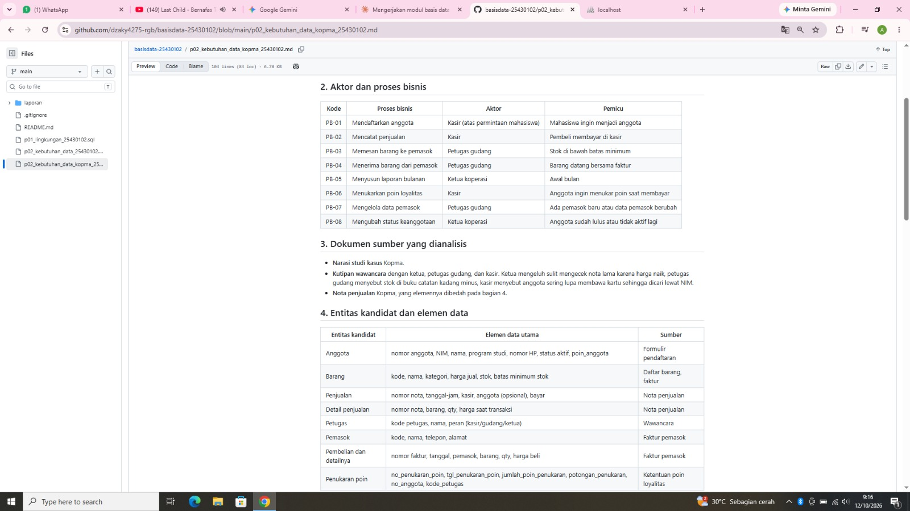
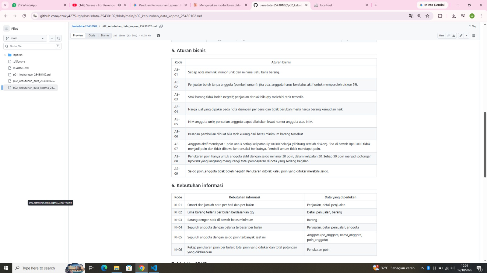
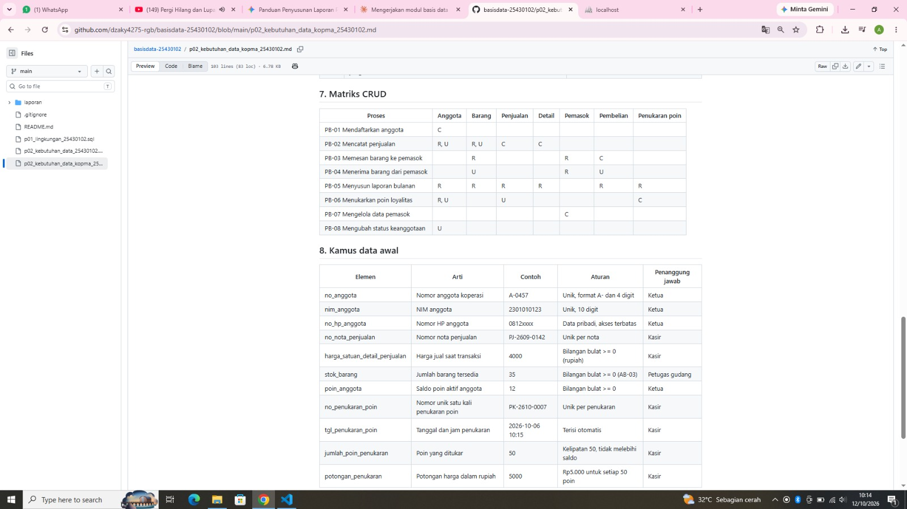
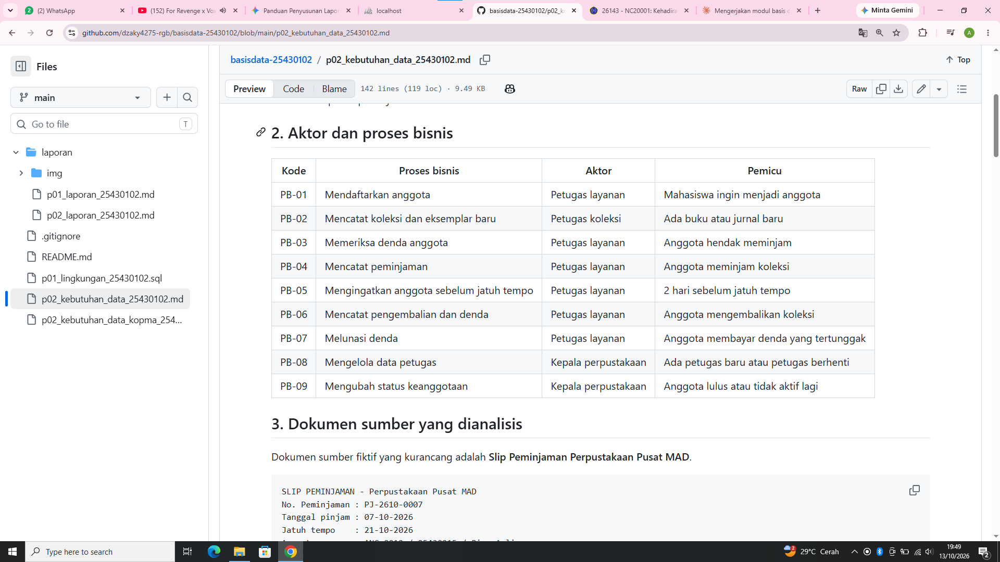
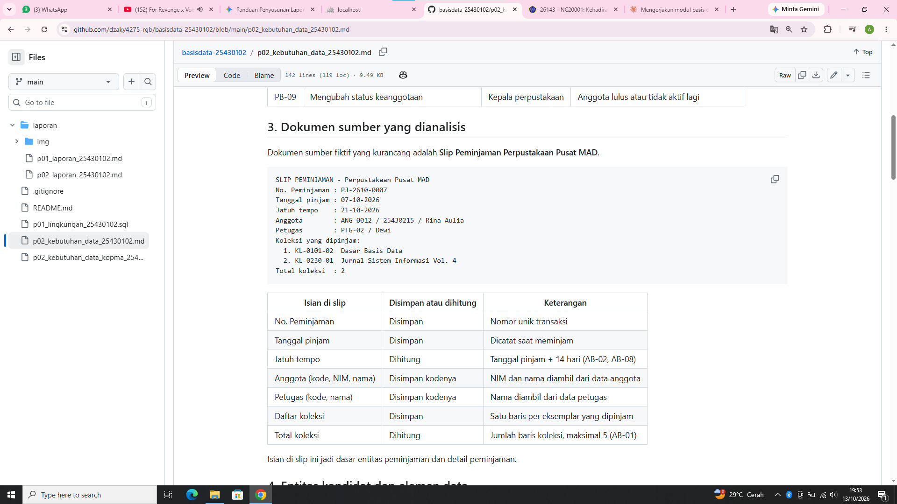
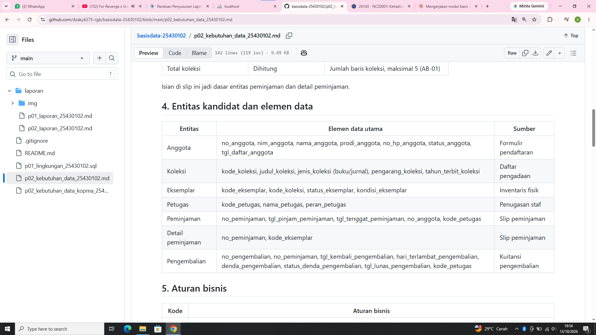
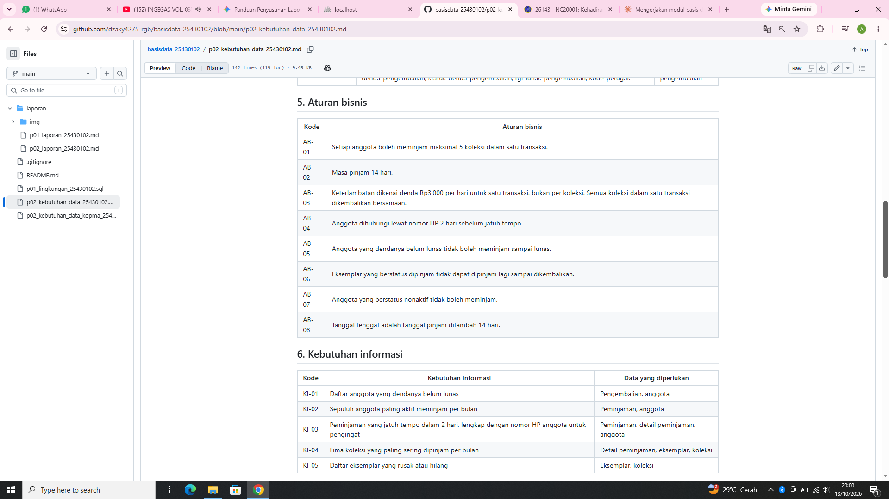
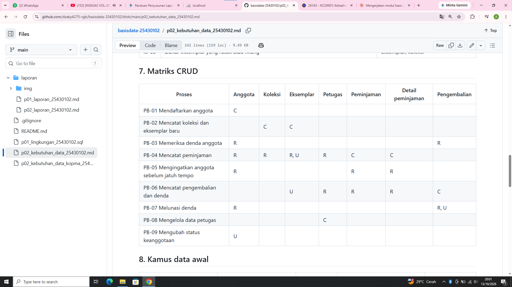
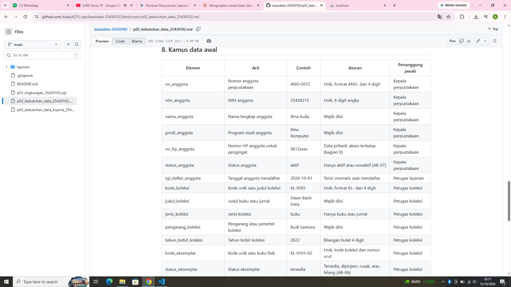
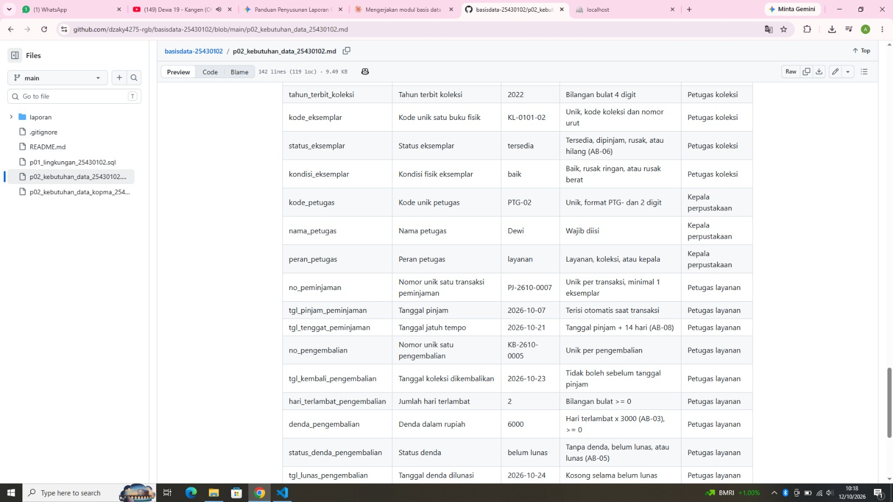

# Laporan Praktikum Basis Data - Pertemuan 02

- **Nama:** Muhammad Alif Dzaky
- **NIM:** 25430102
- **Kelas:** D
- **Tanggal:** 7-12 Oktober 2026
- **Dosen pengampu:** Dedi Irawan, S.Kom., M.T.I.

## 1. Tujuan Praktikum

Di pertemuan ini aku belajar menggali kebutuhan data dari cerita, wawancara, dan nota. Dari situ aku menyusun proses bisnis, entitas, aturan bisnis, matriks CRUD, dan kamus data. Aku juga belajar menulis pernyataan kebutuhan yang jelas dan bisa diuji, lalu menerapkannya ke proyek Perpustakaan Pusat MAD.

## 2. Ringkasan Dasar Teori

Sebelum membuat tabel, kita harus tahu dulu data apa yang dibutuhkan dan kenapa. Kebutuhan digali dari wawancara, pengamatan, dokumen seperti nota atau formulir, dan sistem lama. Hasilnya dikelompokkan menjadi kebutuhan data, kebutuhan informasi, aturan bisnis, dan kebutuhan non-fungsional.

Matriks CRUD (create, read, update, delete) dipakai untuk mengecek apakah setiap data punya proses yang membuatnya. Kamus data mencatat nama elemen, arti, contoh, aturan, dan penanggung jawabnya. Pernyataan kebutuhan yang baik harus spesifik, ada angka atau kondisi, dan bisa diuji.

## 3. Hasil Langkah Percobaan

Dokumen kebutuhan data Kopma ada di berkas `p02_kebutuhan_data_kopma_25430102.md`. Isinya hasil langkah D.2 sampai D.7.

**Proses bisnis (PB-01 sampai PB-08).** Tabel ini mendaftar kegiatan Kopma beserta pelaku dan pemicunya. PB-06 sampai PB-08 kutambahkan: menukarkan poin loyalitas, mengelola data pemasok, dan mengubah status keanggotaan.

**Dokumen sumber.** Bagian ini mencatat bahan analisis: narasi studi kasus, kutipan wawancara, dan nota penjualan. Kutipan wawancara jadi dasar beberapa aturan, misalnya keluhan harga nota lama untuk AB-04 dan stok minus untuk AB-03.

**Entitas dan elemen data.** Delapan entitas Kopma beserta data utamanya. Penukaran poin adalah entitas baru dari latihan E1.

**Aturan bisnis (AB-01 sampai AB-09).** Tiap aturan satu kalimat yang bisa diuji. AB-01 sampai AB-06 dari studi kasus, AB-07 sampai AB-09 untuk poin loyalitas.

**Kebutuhan informasi (KI-01 sampai KI-06).** Pertanyaan yang harus bisa dijawab dari data, misalnya omzet, barang terlaris, dan rekap penukaran poin.

**Matriks CRUD.** Tabel ini menunjukkan proses mana yang membuat, membaca, mengubah, atau menghapus data apa. Setiap kolom punya minimal satu huruf C, jadi tidak ada data tanpa proses pembuatnya. PB-07 mengisi kolom Pemasok dan PB-06 mengisi kolom Penukaran poin.

**Kamus data.** Daftar elemen dengan arti, contoh, aturan, dan penanggung jawabnya. Isinya 11 elemen, termasuk lima elemen poin loyalitas.

## 4. Jawaban Titik Analisis

**Titik Analisis 1**

Nota perlu menyimpan harga saat transaksi karena harga di data barang bisa berubah kapan saja. Kalau nota cuma mengambil harga dari data barang, harga di nota lama ikut berubah setelah harga barang naik, jadi nilai transaksi yang sebenarnya tidak bisa dicek lagi. Ini sama dengan keluhan ketua yang bingung melihat nota lama karena harga barang sering naik. Makanya AB-04 mengatur harga disimpan di setiap baris nota.

**Titik Analisis 2**

Subtotal dan total sebaiknya tidak disimpan karena bisa dihitung ulang dari qty, harga, dan diskon. Kalau disimpan lalu salah satu datanya berubah, angka yang tersimpan bisa tidak cocok dengan hasil hitungan. Total mungkin tetap disimpan supaya angka di nota yang sudah dicetak tidak berubah kalau aturan diskon diganti, dan supaya laporan omzet lebih cepat karena tidak perlu menghitung ulang tiap baris.

**Titik Analisis 3**

Di kolom Pemasok tidak ada huruf C, artinya belum ada proses yang membuat data pemasok, jadi ada proses yang terlewat. Aku menambahkan PB-07 (mengelola data pemasok) yang dilakukan petugas gudang. Kolom Anggota juga hanya punya C dan belum ada proses yang mengubah status aktif, jadi aku menambahkan PB-08 (mengubah status keanggotaan) yang dilakukan ketua, karena ketua penanggung jawab data anggota di kamus data.

## 5. Hasil Latihan dan Modifikasi

### E1 Poin loyalitas

Aku menambahkan fitur poin ke dokumen Kopma:

- **Elemen data baru:** `poin_anggota` di entitas Anggota, dan entitas baru Penukaran poin (nomor penukaran, tanggal, jumlah poin, potongan, anggota, petugas).
- **Aturan bisnis:** AB-07 (poin dihitung setelah diskon, sisa di bawah Rp10.000 hangus, pembeli umum tidak dapat poin), AB-08 (penukaran dalam kelipatan 50 poin), dan AB-09 (saldo poin tidak boleh negatif).
- **Kebutuhan informasi:** KI-05 (sepuluh anggota dengan poin terbanyak) dan KI-06 (rekap penukaran poin per bulan).
- **Proses bisnis:** PB-06 (menukarkan poin loyalitas), dan matriks CRUD diperbarui dengan kolom Penukaran poin.

Aku memilih menyimpan `poin_anggota` sebagai saldo, bukan dihitung ulang dari seluruh riwayat belanja. Alasannya supaya saldo langsung terbaca saat anggota hendak menukar poin dan laporan KI-05 tidak perlu menghitung ulang semua transaksi. Risikonya saldo bisa tidak cocok dengan riwayat kalau salah satu berubah, jadi saldo hanya boleh berubah lewat PB-02 dan PB-06.

### E2 Memperbaiki pernyataan kebutuhan yang kabur

**1. Data anggota aman**

- **Kalimat kabur:** "Sistem harus menjamin data anggota aman."
- **Pernyataan teruji:** Sistem menyembunyikan atribut `no_hp_anggota` dari tampilan layar Kasir dan Petugas Gudang saat pencarian anggota lewat NIM (AB-05), sehingga hanya Ketua yang bisa melihat nomor HP sesuai kebutuhan privasi di bagian 9.

**2. Cepat mencari barang**

- **Kalimat kabur:** "Sistem harus cepat mencari barang."
- **Pernyataan teruji:** Kasir bisa menampilkan hasil pencarian barang berdasarkan nama atau `kode_barang` dalam waktu maksimal 3 detik, dibuktikan lewat 20 kali pencarian berurutan pada basis data berisi 500 data barang.

**3. Laporan stok akurat**

- **Kalimat kabur:** "Laporan stok harus akurat."
- **Pernyataan teruji:** Laporan stok dijaga akurat dengan mencegah stok negatif, yaitu menolak transaksi secara otomatis kalau `qty` penjualan melebihi `stok_barang` sesuai AB-03, dibuktikan dengan 10 simulasi transaksi yang semuanya ditolak saat `qty` melebihi stok.

## 6. Tugas Mandiri: Milestone Proyek 02

Dokumen kebutuhan data proyek ada di berkas `p02_kebutuhan_data_25430102.md`.

**Proses bisnis (PB-01 sampai PB-09).** Sembilan kegiatan Perpustakaan Pusat MAD, dari mendaftarkan anggota sampai mengubah status keanggotaan. Pemeriksaan denda (PB-03) kupisah dari peminjaman (PB-04) supaya satu proses satu tugas.

**Slip peminjaman.** Dokumen sumber fiktifku. Tiap isian ditandai disimpan atau dihitung, misalnya jatuh tempo dihitung dari tanggal pinjam ditambah 14 hari.

**Entitas dan elemen data.** Tujuh entitas: anggota, koleksi, eksemplar, petugas, peminjaman, detail peminjaman, dan pengembalian. Koleksi dan eksemplar dipisah karena satu judul bisa punya beberapa buku fisik.

**Aturan bisnis (AB-01 sampai AB-08).** Aturan berasal dari README dan parameter P: maksimal 5 koleksi, masa pinjam 14 hari, denda Rp3.000 per hari per transaksi, pengingat 2 hari sebelum jatuh tempo, dan larangan meminjam kalau denda belum lunas.

**Kebutuhan informasi (KI-01 sampai KI-05).** Pertanyaan untuk kepala perpustakaan, misalnya anggota yang dendanya belum lunas dan peminjaman yang jatuh tempo dalam 2 hari.

**Matriks CRUD.** Setiap entitas punya proses yang membuatnya. Petugas dibuat lewat PB-08, dan PB-07 (melunasi denda) mengubah status denda supaya status "belum lunas" bisa berubah.

**Kamus data.** Dua puluh tujuh elemen dengan arti, contoh, aturan, dan penanggung jawab, dibagi dua gambar karena tabelnya panjang. NIM ditulis 8 digit sesuai NIM sebenarnya.

**Perhitungan parameter P:** dua digit terakhir NIM adalah 02, jadi P = (02 mod 9) + 1 = 3. Dari situ, batas maksimal koleksi per transaksi P + 2 = 5, denda harian P = Rp3.000, dan perkiraan volume harian 40 + 5 x 3 = 55 transaksi.

**Ketentuan minimum yang dipenuhi:** 9 proses bisnis, 7 entitas, 8 aturan bisnis, 5 kebutuhan informasi, kamus data 27 elemen dengan penanggung jawab, kebutuhan non-fungsional dengan data pribadi, dan satu dokumen sumber fiktif (slip peminjaman).

**Keputusan desain yang penting:**

- **Koleksi dan eksemplar dipisah.** Yang dipinjam adalah satu buku fisik tertentu, bukan judulnya. Dengan begitu status tiap eksemplar (tersedia, dipinjam, rusak, hilang) bisa dilacak dan AB-06 mudah diuji.
- **Buku dan jurnal digabung dalam satu entitas koleksi** dengan kolom jenis, karena aturan pinjam keduanya sama.
- **Denda dihitung per transaksi dan disimpan di pengembalian.** Satu pengembalian punya satu denda, dan status denda dipakai untuk memeriksa AB-05.
- **Pemeriksaan denda (PB-03) dibuat proses sendiri** dan dijalankan sebelum peminjaman (PB-04). Aku juga menambah PB-07 (melunasi denda) supaya status "belum lunas" bisa berubah.
- **Kolom Petugas punya proses pembuatnya (PB-08)**, belajar dari Titik Analisis 3 di Kopma.
- **Nomor HP boleh dilihat petugas layanan dan kepala perpustakaan**, karena PB-05 butuh nomor itu untuk menghubungi anggota.

## 7. Pembahasan dan Kendala

**Kendala 1: Berkas baru masuk ke folder yang salah.** Waktu membuat berkas `p02`, berkasnya masuk ke folder `laporan`, bukan folder utama. VS Code membuat berkas baru di folder yang terakhir diklik. Aku memindahkannya dengan drag and drop ke judul folder utama.

**Kendala 2: Tampilan GitHub diterjemahkan Chrome.** Tabel di GitHub sempat tampil dengan tulisan yang berubah, misalnya Pemasok menjadi "Perusahaan tersebut" dan "mahasiswa" menjadi "pelajar". Isi berkas di VS Code tetap benar, penyebabnya terjemahan otomatis Chrome. Aku mematikan terjemahannya dan mengambil ulang tangkapan layar. Terjemahan itu sempat menyala lagi, jadi tiap mengambil gambar aku cek ulang tulisannya.

**Kendala 3: Tangkapan layar terlalu kecil.** Waktu tampilan browser kuperkecil supaya satu layar memuat banyak bagian, tulisannya jadi tidak terbaca. Aku memecahnya jadi beberapa gambar per dokumen, dan memberi penjelasan tertulis untuk tiap tabel.

**Kendala 4: Gambar tidak muncul di laporan.** Gambar yang kukirim lewat WhatsApp berubah menjadi JPEG, sehingga setelah kuganti nama jadi berekstensi ganda (`.png.jpeg`). Ada juga file yang tidak bisa dibuka karena tersimpan dari halaman web lewat Ctrl+S, dan menghasilkan folder berakhiran `_files`. Folder itu kuhapus, lalu gambar kuambil ulang dengan Win + Shift + S dan kusimpan sebagai PNG lewat Paint.

**Kendala 5: Rujukan di pernyataan kebutuhan salah.** Di pernyataan "data anggota aman" aku sempat menulis atribut alamat, padahal alamat milik pemasok, dan menyebut bagian 9 sebagai aturan bisnis padahal itu kebutuhan non-fungsional. Aku mencocokkannya lagi dengan dokumen Kopma lalu memperbaikinya.

**Kendala 6: Nama proses tidak konsisten.** Ada nama proses yang berubah-ubah, misalnya PB-07 sempat tertulis "mengelola data pembelian" padahal soal pemasok. Aku menyeragamkan nama proses di tabel proses bisnis dan matriks CRUD.

## 8. Kesimpulan

Dari pertemuan ini aku jadi paham bahwa kebutuhan data harus digali dulu dari cerita, wawancara, dan dokumen sebelum membuat tabel. Matriks CRUD membantuku menemukan proses yang terlewat, dan pernyataan kebutuhan harus punya angka atau kondisi supaya bisa diuji. Pada proyek perpustakaan, keputusan seperti memisahkan eksemplar dari koleksi dan menyimpan status denda ternyata berpengaruh ke banyak aturan.

## 9. Pernyataan Penggunaan AI

Aku memakai Claude selama mengerjakan modul ini. Bantuannya:

- menjelaskan konsep dan memberi pertanyaan pemandu untuk Titik Analisis dan latihan,
- memeriksa dan memberi masukan pada pernyataan kebutuhan (E2), aturan bisnis, kebutuhan informasi, dan matriks CRUD,
- menyusun draf dokumen Kopma (termasuk tambahan E1), dokumen proyek Perpustakaan, penjelasan tiap tabel, dan draf laporan ini, yang kemudian kusalin dan kusesuaikan,
- membantu mencari penyebab masalah teknis, misalnya tangkapan layar yang tidak tampil.

Yang kukerjakan sendiri: menjalankan semua langkah di VS Code dan Git, mengambil semua tangkapan layar, memilih aturan bisnis dan kebutuhan informasi, memutuskan masa pinjam 14 hari dan denda per transaksi, serta memeriksa dan menyesuaikan isi dokumen dan laporan ini.

## 10. Bukti Git

- **Tautan repositori:** https://github.com/dzaky4275-rgb/basisdata-25430102
- **Commit dokumen Kopma:** 93a4d16 (pesan: p02: dokumen kebutuhan data kopma)
- **Commit dokumen proyek dan laporan:** tercatat di riwayat commit repositori (tab Commits) dengan awalan pesan `p02:`

## Checklist

**Checklist umum**

- [x] Identitas (nama, NIM, kelas, tanggal, nama dosen)
- [x] Tujuan praktikum (bahasa sendiri, maksimal 5 baris)
- [x] Ringkasan teori (maksimal setengah halaman)
- [x] Langkah percobaan (D) dengan tangkapan layar dan keterangan
- [x] Semua Titik Analisis dijawab beserta alasan
- [x] Latihan (E) beserta bukti
- [x] Tugas Mandiri (F): berkas, bukti, dan penjelasan keputusan
- [x] Pembahasan dan kendala
- [x] Kesimpulan
- [x] Pernyataan Penggunaan AI
- [x] Bukti Git (tautan repositori dan hash commit)
- [x] Keaslian (tangkapan layar memperlihatkan jam, nama organisasi dan dokumen sumber fiktif milikku)

**Checklist khusus Pertemuan 2**

- [x] Berkas wajib: `p02_kebutuhan_data_kopma_25430102.md` dan `p02_kebutuhan_data_25430102.md`
- [x] Bukti: tabel PB, AB, KI, matriks CRUD, dan kamus data di berkas proyek (tampilan GitHub)
- [x] Analisis wajib: Titik Analisis 1 sampai 3
- [x] Analisis wajib: perhitungan parameter P
- [x] Analisis wajib: perbaikan tiga pernyataan kebutuhan kabur