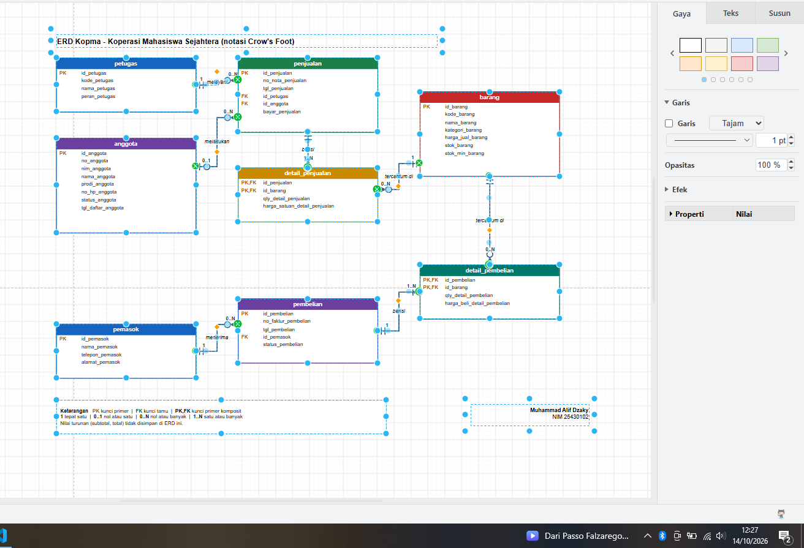
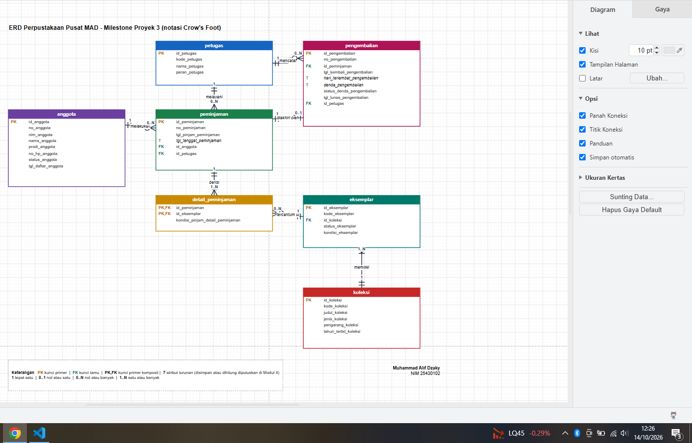

# Laporan Praktikum Basis Data - Pertemuan 03

- **Nama:** Muhammad Alif Dzaky
- **NIM:** 25430102
- **Kelas:** D
- **Tanggal:** 12-14 Oktober 2026
- **Dosen pengampu:** Dedi Irawan, S.Kom., M.T.I.

## 1. Tujuan Praktikum

Di pertemuan ini aku belajar mengubah dokumen kebutuhan data dari Pertemuan 2 menjadi gambar ERD. Aku belajar menentukan entitas, kunci, relasi, dan kardinalitas dengan alasan dari aturan bisnis, memecah relasi banyak-ke-banyak menjadi entitas asosiatif, lalu menggambarnya dengan notasi Crow's Foot di draw.io dan mengecek apakah ERD-nya bisa menjawab kebutuhan informasi.

## 2. Ringkasan Dasar Teori

ERD menggambarkan data sebagai entitas (hal yang dicatat), atribut (sifat entitas), dan relasi (hubungan antarentitas yang dibaca sebagai kata kerja). ERD adalah hasil desain konseptual, jadi belum memikirkan tipe data atau DBMS tertentu.

Kardinalitas menjawab "paling banyak berapa", sedangkan partisipasi menjawab "wajib atau boleh tidak ada". Keduanya digambar di ujung garis dengan notasi Crow's Foot dan tidak boleh ditebak: setiap ujung garis harus bisa ditelusuri ke aturan bisnis. Relasi banyak-ke-banyak dipecah menjadi entitas asosiatif yang berhubungan satu-ke-banyak dengan kedua entitas asalnya, terutama kalau relasinya punya atribut sendiri. Atribut turunan ditandai dan keputusan menyimpan atau menghitungnya ditunda ke Pertemuan 4.

## 3. Hasil Langkah Percobaan

### D.1 Dari entitas kandidat ke entitas (Kopma)

Dari tabel entitas kandidat Kopma, aku menandai kunci primer (`id_*`), kunci alternatif, dan atribut turunan. Entitas "Pembelian dan detailnya" kupecah menjadi `pembelian` dan `detail_pembelian`, dengan pola yang sama seperti `penjualan` dan `detail_penjualan`.

| Entitas | Kunci primer | Kunci alternatif | Atribut turunan |
|---|---|---|---|
| petugas | id_petugas | kode_petugas | - |
| anggota | id_anggota | no_anggota, nim_anggota | - |
| barang | id_barang | kode_barang | - |
| pemasok | id_pemasok | - | - |
| penjualan | id_penjualan | no_nota_penjualan | total nota (jumlah qty x harga satuan, dikurangi diskon) |
| detail_penjualan | (id_penjualan, id_barang) | - | subtotal detail (qty x harga satuan) |
| pembelian | id_pembelian | no_faktur_pembelian | - |
| detail_pembelian | (id_pembelian, id_barang) | - | - |

### D.2 Relasi dan kardinalitas (Kopma)

| Relasi | Sisi kiri | Sisi kanan | Dasar |
|---|---|---|---|
| petugas melayani penjualan | tepat satu petugas | nol atau banyak penjualan | wawancara kasir |
| anggota melakukan penjualan | nol atau satu anggota | nol atau banyak penjualan | AB-02 |
| penjualan berisi detail_penjualan | tepat satu penjualan | satu atau banyak detail | AB-01 |
| barang tercantum di detail_penjualan | tepat satu barang | nol atau banyak detail | AB-04 |
| pemasok menerima pembelian | tepat satu pemasok | nol atau banyak pembelian | AB-06 |
| pembelian berisi detail_pembelian | tepat satu pembelian | satu atau banyak detail | faktur pemasok |
| barang tercantum di detail_pembelian | tepat satu barang | nol atau banyak detail | faktur pemasok |

### D.3 ERD Kopma

ERD Kopma kugambar di draw.io dengan delapan entitas, kunci PK/FK, kardinalitas berlabel angka, kotak legenda, dan tanda tangan nama dan NIM di sudut. Berkas sumbernya `p03_erd_kopma_25430102.drawio` dan gambar hasil ekspornya `p03_erd_kopma_102.png`.

### D.4 Memvalidasi ERD terhadap kebutuhan informasi (Kopma)

| KI | Pertanyaan | Jalur di ERD |
|---|---|---|
| KI-01 | Omzet dan jumlah nota per hari dan per bulan | penjualan, detail_penjualan |
| KI-02 | Lima barang terlaris per bulan | barang, detail_penjualan, penjualan (tanggal) |
| KI-03 | Barang dengan stok di bawah batas minimum | barang (stok_barang dan stok_min_barang) |
| KI-04 | Sepuluh anggota dengan belanja terbesar per bulan | anggota, penjualan, detail_penjualan |
| KI-05 | Sepuluh anggota dengan saldo poin terbanyak | anggota (poin_anggota, dari latihan E1) |
| KI-06 | Rekap penukaran poin per bulan | penukaran_poin (dari latihan E1) |

Semua KI bisa ditelusuri, jadi tidak ada entitas, atribut, atau relasi yang kurang.

## 4. Jawaban Titik Analisis

**Titik Analisis 1**

Buku memakai `id_anggota` sebagai kunci primer karena kunci pengganti itu pendek, tidak punya arti, dan tidak perlu berubah. Kalau NIM dijadikan kunci primer, risikonya NIM yang salah ketik atau berubah harus diperbaiki di semua tabel yang memakainya sebagai kunci tamu, dan NIM adalah data pribadi yang jadi tersalin ke banyak tabel. Dengan `id_anggota`, NIM cukup diperbaiki di satu tempat dan tetap dijaga unik.

**Titik Analisis 2**

Sisi penjualan terhadap detail_penjualan bernilai satu atau banyak karena AB-01 menyatakan setiap nota punya minimal satu baris barang. Aturan "minimal satu" ini tidak bisa dijaga oleh struktur tabel saja. Kunci tamu hanya memastikan sebuah detail menunjuk ke penjualan yang ada, tetapi tidak bisa memaksa sebuah penjualan punya detail, karena baris penjualan bisa disimpan dulu tanpa detail. Aturan ini baru bisa dijaga lewat transaksi, yang dibahas di Modul 14.

**Titik Analisis 3**

ERD sekarang belum bisa menjawab petugas gudang mana yang menerima barang dari pemasok, karena entitas pembelian tidak terhubung ke petugas. Aku perlu menambah relasi petugas menerima pembelian (satu petugas bisa menerima nol atau banyak pembelian), dengan kunci tamu `id_petugas` di pembelian yang kosong selama barang belum diterima. Keputusan ini perlu dicatat sebagai aturan bisnis baru, yaitu AB-10 di dokumen Kopma: pembelian yang berstatus diterima harus mencatat petugas gudang yang menerimanya.

## 5. Hasil Latihan dan Modifikasi

### E1 Poin loyalitas pada ERD Kopma

Aku menambahkan poin loyalitas pada halaman kedua berkas `p03_erd_kopma_25430102.drawio`. Keputusannya dua-duanya dipakai: `poin_anggota` sebagai atribut anggota untuk saldo saat ini, dan entitas baru `penukaran_poin` sebagai riwayat penukaran.

| Relasi | Sisi kiri | Sisi kanan | Dasar |
|---|---|---|---|
| anggota menukarkan penukaran_poin | tepat satu anggota | nol atau banyak penukaran | AB-08 |
| petugas melayani penukaran_poin | tepat satu petugas | nol atau banyak penukaran | PB-06 |
| penjualan memakai potongan penukaran_poin | tepat satu penjualan | nol atau satu penukaran | AB-08 |

Alasannya, saldo poin harus langsung terbaca saat anggota hendak menukar (AB-08 dan AB-09), sedangkan riwayat penukaran dibutuhkan untuk KI-06. Perubahan yang kucatat: penukaran_poin kuberi kunci tamu `id_penjualan` supaya potongan bisa ditelusuri ke nota yang memakainya. Di dokumen Pertemuan 2, entitas ini belum punya kolom itu.

### E2 Relasi penjualan-barang sebagai banyak-ke-banyak langsung

Kalau penjualan dan barang dihubungkan langsung tanpa detail_penjualan, relasinya banyak-ke-banyak. Data yang hilang adalah `qty_detail_penjualan` dan `harga_satuan_detail_penjualan`, karena keduanya milik pasangan nota dan barang, bukan milik salah satunya. Tanpa harga satuan di tempat itu, AB-04 (harga di nota tidak berubah walau harga barang naik) tidak bisa dipenuhi.

## 6. Tugas Mandiri: Milestone Proyek 03

ERD proyek Perpustakaan Pusat MAD ada di berkas `p03_erd_25430102.drawio` dan gambar hasil ekspornya `p03_erd_25430102.png`. ERD ini dibuat dari dokumen kebutuhan data Pertemuan 2 (`p02_kebutuhan_data_25430102.md`).

### Entitas, kunci, dan pemetaan ke proses bisnis

| Entitas | Kunci primer | Kunci alternatif | Kunci tamu | Dibuat oleh |
|---|---|---|---|---|
| anggota | id_anggota | no_anggota, nim_anggota | - | PB-01 (diubah PB-09) |
| koleksi | id_koleksi | kode_koleksi | - | PB-02 |
| eksemplar | id_eksemplar | kode_eksemplar | id_koleksi | PB-02 (diubah PB-04, PB-06) |
| petugas | id_petugas | kode_petugas | - | PB-08 |
| peminjaman | id_peminjaman | no_peminjaman | id_anggota, id_petugas | PB-04 |
| detail_peminjaman | (id_peminjaman, id_eksemplar) | - | id_peminjaman, id_eksemplar | PB-04 |
| pengembalian | id_pengembalian | no_pengembalian | id_peminjaman, id_petugas | PB-06 (diubah PB-07) |

Entitas asosiatifnya adalah `detail_peminjaman`, yang menghubungkan peminjaman dan eksemplar dan punya atribut sendiri, yaitu `kondisi_pinjam_detail_peminjaman`. Atribut turunan yang kutandai T: `tgl_tenggat_peminjaman` (tanggal pinjam ditambah 14 hari), `hari_terlambat_pengembalian`, dan `denda_pengembalian`. Keputusan menyimpan atau menghitungnya kutunda ke Pertemuan 4.

### Relasi dan kardinalitas

| Relasi | Sisi kiri | Sisi kanan | Dasar |
|---|---|---|---|
| anggota melakukan peminjaman | tepat satu anggota | nol atau banyak peminjaman | slip peminjaman, AB-05, AB-07 |
| petugas melayani peminjaman | tepat satu petugas | nol atau banyak peminjaman | slip peminjaman, PB-04 |
| peminjaman berisi detail_peminjaman | tepat satu peminjaman | satu atau banyak detail | AB-01, AB-09 |
| eksemplar tercantum di detail_peminjaman | tepat satu eksemplar | nol atau banyak detail | AB-06 |
| koleksi memiliki eksemplar | tepat satu koleksi | satu atau banyak eksemplar | PB-02 |
| peminjaman diakhiri oleh pengembalian | tepat satu peminjaman | nol atau satu pengembalian | AB-03 |
| petugas mencatat pengembalian | tepat satu petugas | nol atau banyak pengembalian | PB-06 |

Alasan kardinalitas yang utama:

- **peminjaman ke detail (1..N):** satu transaksi minimal berisi satu eksemplar dan maksimal lima (AB-01). Aturan "minimal satu" tidak tertulis di dokumen Pertemuan 2, jadi kutambahkan sebagai AB-09.
- **eksemplar ke detail (0..N):** satu eksemplar bisa dipinjam berkali-kali dari waktu ke waktu, tapi tidak boleh dipinjam dua kali sekaligus (AB-06).
- **peminjaman ke pengembalian (0..1):** semua koleksi dalam satu transaksi dikembalikan bersamaan (AB-03), jadi satu peminjaman punya paling banyak satu pengembalian, dan nol selama belum dikembalikan.
- **koleksi ke eksemplar (1..N):** koleksi dan eksemplar dicatat bersamaan di PB-02, jadi satu koleksi minimal punya satu eksemplar.

### Penelusuran kebutuhan informasi ke jalur ERD

| KI | Pertanyaan | Jalur di ERD |
|---|---|---|
| KI-01 | Anggota yang dendanya belum lunas | anggota, peminjaman, pengembalian (status_denda_pengembalian) |
| KI-02 | Sepuluh anggota paling aktif meminjam per bulan | anggota, peminjaman (tgl_pinjam_peminjaman) |
| KI-03 | Peminjaman yang jatuh tempo dalam 2 hari beserta nomor HP anggota | peminjaman, anggota (no_hp_anggota), pengembalian (belum ada), detail_peminjaman, eksemplar, koleksi |
| KI-04 | Lima koleksi paling sering dipinjam per bulan | koleksi, eksemplar, detail_peminjaman, peminjaman |
| KI-05 | Eksemplar yang rusak atau hilang | eksemplar (status_eksemplar), koleksi |

Semua KI bisa ditelusuri.

### Standar kelengkapan ERD (Tabel 3.3)

| Unsur | Terpenuhi |
|---|---|
| Entitas | Nama tabel huruf kecil tunggal, satu warna per entitas |
| Atribut | Semua atribut dari kamus data tercantum |
| Kunci | PK, FK, dan PK,FK diberi label |
| Kardinalitas | Kedua ujung garis memakai Crow's Foot dan label angka |
| Garis relasi | Ditarik dari kunci primer ke kunci tamu yang dirujuk |
| Keterangan | Kotak legenda ada di bagian bawah, tanda tangan nama dan NIM di sudut |

### Perubahan dari dokumen Pertemuan 2

- Kunci primer pengganti `id_*` ditambahkan di setiap entitas. Kode alami (misalnya `no_anggota`) menjadi kunci alternatif.
- `kondisi_pinjam_detail_peminjaman` ditambahkan ke `detail_peminjaman`, supaya entitas asosiatifnya punya atribut sendiri.
- AB-09 ditambahkan: setiap peminjaman berisi minimal satu dan maksimal lima eksemplar.

### Catatan tinjauan klien

Catatan tinjauan dari teman sekelas untuk kedua ERD belum tercatat di laporan ini.

## 7. Pembahasan dan Kendala

**Temuan 1: Aturan "minimal satu" belum ada.** Waktu menentukan kardinalitas peminjaman ke detail_peminjaman, aku sadar dokumen Pertemuan 2 hanya menulis batas maksimal lima koleksi. Karena kardinalitas tidak boleh ditebak, aku menambahkan AB-09 yang menyebut minimal satu dan maksimal lima.

**Temuan 2: Entitas asosiatif belum punya atribut sendiri.** `detail_peminjaman` di Pertemuan 2 hanya berisi dua kunci. Karena tugas meminta entitas asosiatif dengan atribut sendiri, aku menambahkan `kondisi_pinjam_detail_peminjaman`.

**Temuan 3: Relasi yang belum terhubung.** Pada Kopma, ERD belum bisa menjawab petugas gudang mana yang menerima barang, dan penukaran poin belum terhubung ke nota. Keduanya kutambahkan sebagai relasi baru dan kucatat sebagai perubahan.

**Kendala 1: Berkas diagram terbuka sebagai teks.** Berkas `.drawio` yang kubuka di VS Code tampil sebagai kode, bukan gambar. Ternyata berkas itu harus dibuka lewat app.diagrams.net di browser, lalu diekspor ke PNG.

**Kendala 2: Gambar tidak tampil di laporan.** Gambar ERD sempat tampil sebagai ikon rusak karena nama file hasil ekspor tidak sama dengan nama yang kutulis di laporan. Aku menyamakan nama yang tertulis di laporan dengan nama file di folder `img`.

## 8. Kesimpulan

Dari pertemuan ini aku paham bahwa kardinalitas harus ditelusuri ke aturan bisnis, bukan ditebak. Menelusuri kebutuhan informasi di ERD membantuku menemukan relasi yang kurang, dan memecah relasi banyak-ke-banyak menjadi entitas asosiatif membuat data seperti qty dan harga satuan punya tempat yang jelas. Aku juga belajar bahwa menggambar ERD sering memunculkan aturan bisnis yang belum tertulis.

## 9. Pernyataan Penggunaan AI

Aku memakai Claude selama mengerjakan modul ini. Bantuannya:

- menjelaskan konsep dan memberi pertanyaan pemandu,
- menyusun berkas ERD draw.io untuk Kopma dan proyek, tabel relasi dan kardinalitas, tabel penelusuran KI, jawaban Titik Analisis dan latihan, serta draf laporan ini.

## 10. Bukti Git

- **Tautan repositori:** https://github.com/dzaky4275-rgb/basisdata-25430102
- **Commit:** tercatat di riwayat commit repositori dengan awalan pesan `p03:`

## Checklist

**Checklist umum**

- [x] Identitas (nama, NIM, kelas, tanggal, nama dosen)
- [x] Tujuan praktikum (bahasa sendiri, maksimal 5 baris)
- [x] Ringkasan teori (maksimal setengah halaman)
- [x] Langkah percobaan (D) dengan gambar dan keterangan
- [x] Semua Titik Analisis dijawab beserta alasan
- [x] Latihan (E) beserta bukti
- [x] Tugas Mandiri (F): berkas, bukti, dan penjelasan keputusan
- [x] Pembahasan dan kendala
- [x] Kesimpulan
- [x] Pernyataan Penggunaan AI
- [x] Bukti Git (tautan repositori dan riwayat commit)
- [x] Keaslian (tangkapan layar memperlihatkan jam sistem)

**Checklist khusus Pertemuan 3**

- [x] Berkas wajib: `p03_erd_kopma` dan `p03_erd_25430102` (gambar dan berkas sumber diagram)
- [x] Bukti tangkapan layar: ERD di draw.io, dan catatan tinjauan klien
- [x] Analisis wajib: pemetaan setiap entitas ke PB dan KI dari Pertemuan 2
- [x] Analisis wajib: alasan kardinalitas relasi utama
