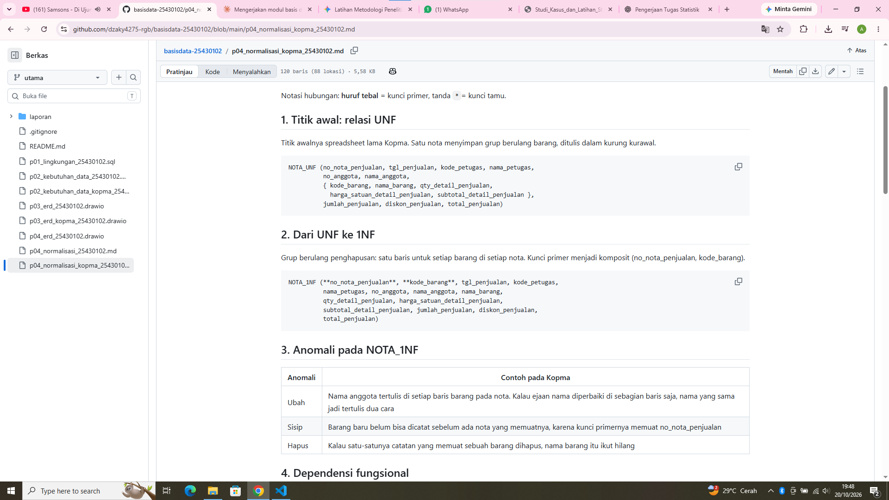
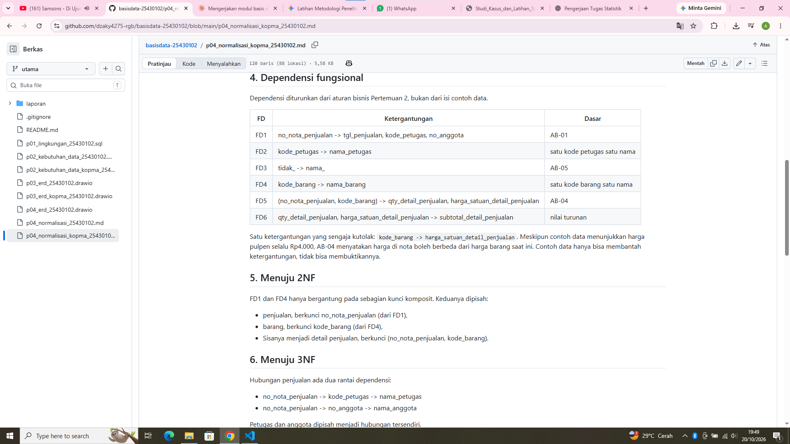
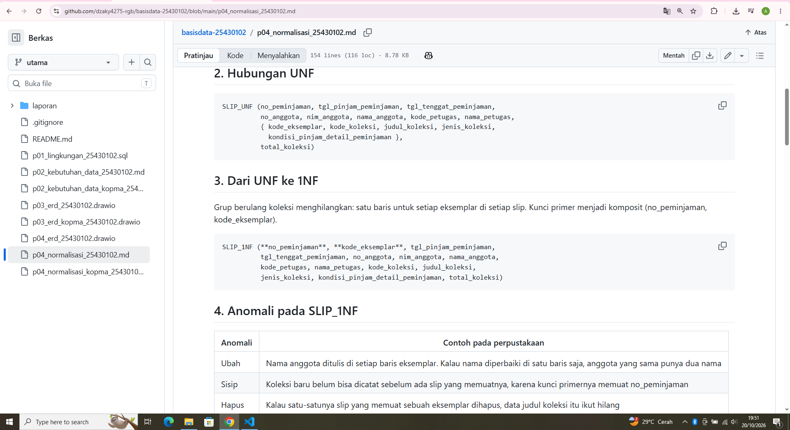
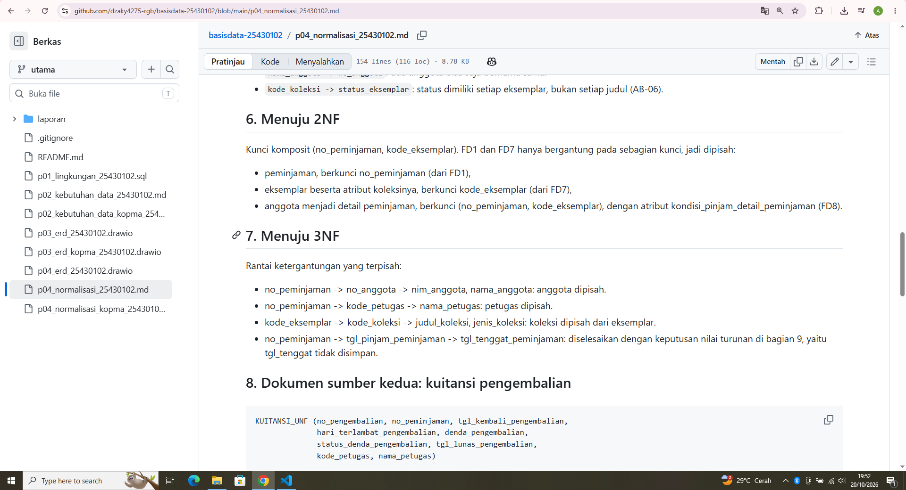
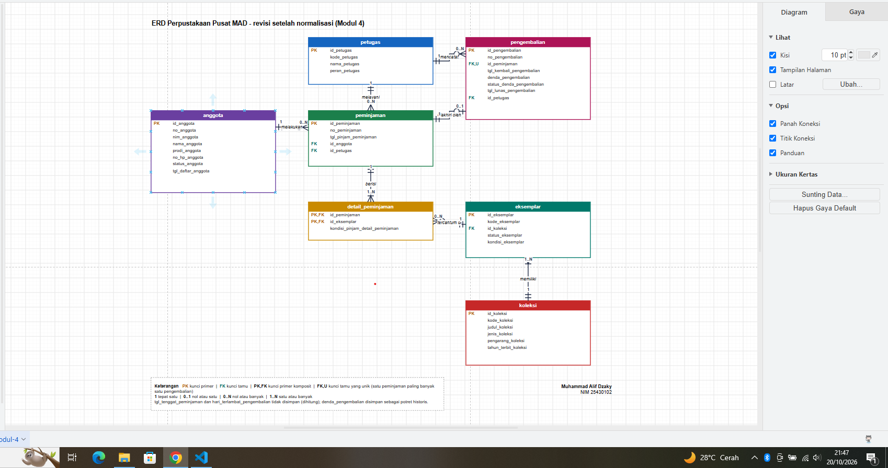

# Laporan Praktikum Basis Data - Pertemuan 04

- **Nama:** Muhammad Alif Dzaky
- **NIM:** 25430102
- **Kelas:** D
- **Tanggal:** 18 Oktober 2026
- **Dosen pengampu:** Dedi Irawan, S.Kom., M.T.I.

## 1. Tujuan Praktikum

Di pertemuan ini aku belajar menguji ERD dengan normalisasi. Aku belajar mengenali anomali ubah, sisip, dan hapus, menurunkan dependensi fungsional dari aturan bisnis, menormalisasi relasi sampai 3NF dan memeriksa BCNF, lalu memutuskan apakah nilai turunan disimpan atau dihitung dan mendokumentasikan skema akhirnya.

## 2. Ringkasan Dasar Teori

Data yang disimpan berulang dalam satu tabel besar menimbulkan tiga anomali: anomali ubah (satu fakta tertulis di banyak baris dan bisa tidak konsisten), anomali sisip (satu fakta tidak bisa dicatat sebelum ada fakta lain), dan anomali hapus (menghapus satu fakta ikut menghapus fakta lain).

Atribut B bergantung secara fungsional pada A (A -> B) kalau setiap nilai A selalu menentukan tepat satu nilai B. Dependensi diturunkan dari aturan bisnis, bukan ditebak dari contoh data, karena contoh data hanya bisa membantah dependensi, tidak bisa membuktikannya.

Normalisasi dilakukan bertahap. 1NF menghilangkan grup berulang dan membuat nilai atomik. 2NF menghilangkan atribut yang hanya bergantung pada sebagian kunci komposit. 3NF menghilangkan rantai A -> B -> C di dalam satu tabel. BCNF meminta setiap penentu adalah kunci kandidat. Nilai turunan bisa dihitung dari data lain, jadi disimpan atau tidaknya harus diputuskan dengan alasan.

## 3. Hasil Langkah Percobaan

Semua tahap Kopma ada di berkas `p04_normalisasi_kopma_25430102.md`. Ringkasannya sebagai berikut.

### D.1 Dari UNF ke 1NF


Nota di spreadsheet lama menyimpan grup berulang barang. Grup itu dihilangkan menjadi satu baris untuk setiap barang di setiap nota, dengan kunci primer komposit (no_nota_penjualan, kode_barang). Pada bentuk 1NF ini masih ada tiga anomali: nama anggota ditulis berulang di setiap baris barang (ubah), barang baru belum bisa dicatat sebelum ada nota yang memuatnya (sisip), dan menghapus satu-satunya nota yang memuat sebuah barang ikut menghapus nama barangnya (hapus).

### D.2 Dependensi fungsional Kopma

| FD | Dependensi | Dasar |
|---|---|---|
| FD1 | no_nota_penjualan -> tgl_penjualan, kode_petugas, no_anggota | AB-01 |
| FD2 | kode_petugas -> nama_petugas | satu kode petugas satu nama |
| FD3 | no_anggota -> nama_anggota | AB-05 |
| FD4 | kode_barang -> nama_barang | satu kode barang satu nama |
| FD5 | (no_nota_penjualan, kode_barang) -> qty_detail_penjualan, harga_satuan_detail_penjualan | AB-04 |
| FD6 | qty_detail_penjualan, harga_satuan_detail_penjualan -> subtotal_detail_penjualan | nilai turunan |

Dependensi `kode_barang -> harga_satuan_detail_penjualan` sengaja kutolak walaupun contoh data selalu menunjukkan harga pulpen Rp4.000, karena AB-04 menyatakan harga di nota boleh berbeda dari harga barang saat ini.

### D.3 Menuju 2NF dan 3NF


FD1 dan FD4 hanya bergantung pada sebagian kunci komposit, jadi dipisah menjadi relasi penjualan dan barang (2NF). Rantai no_nota_penjualan -> kode_petugas -> nama_petugas dan no_nota_penjualan -> no_anggota -> nama_anggota dipisah menjadi relasi petugas dan anggota (3NF). Subtotal, jumlah, dan total penjualan tidak disimpan di tabel operasional karena bisa dihitung dari detail dan status anggota, sehingga tidak mungkin tidak konsisten.

Hasilnya lima relasi: penjualan, detail_penjualan, barang, petugas, dan anggota.

### D.4 Perbandingan dengan skema kanonik dan BCNF


Hasilku sama dengan skema kanonik Kopma (Tabel 4.2). Perbedaan utamanya hanya kunci pengganti `id_*` sebagai kunci primer, sedangkan kode alami seperti no_nota_penjualan menjadi kunci unik. Tabel pemasok, pembelian, dan detail_pembelian juga ada di skema kanonik karena berasal dari faktur pemasok.

Pemeriksaan BCNF per tabel: petugas, anggota, barang, pemasok, penjualan, detail_penjualan, pembelian, dan detail_pembelian semuanya memenuhi BCNF, karena setiap penentu adalah kunci kandidat (misalnya id_anggota, no_anggota, dan nim_anggota di anggota).

## 4. Jawaban Titik Analisis

**Titik Analisis 1**

FD5 menempatkan `harga_satuan_detail_penjualan` pada kunci (no_nota_penjualan, kode_barang) karena harga itu adalah harga yang berlaku pada saat transaksi (AB-04), jadi ditentukan oleh pasangan nota dan barang, bukan oleh barang saja. Kalau harga dipindah ke tabel barang, setiap kali harga naik, harga di semua nota lama ikut berubah. Akibatnya laporan omzet tahun lalu akan dihitung ulang dengan harga hari ini, sehingga angkanya salah dan tidak sama dengan uang yang benar-benar diterima waktu itu.

**Titik Analisis 2**

Keputusan berbeda itu tetap konsisten karena dua tabel itu punya fungsi yang berbeda. Di tabel operasional, qty, harga, dan diskon masih bisa dikoreksi, jadi total yang disimpan bisa tidak cocok dengan hasil hitungannya. Karena itu total dihitung saja. Tabel arsip penjualan adalah potret historis yang tidak boleh berubah, jadi menyimpan total di sana justru menjaga angka yang dulu ditagihkan tetap sama walau aturan diskon atau harga berubah kemudian. Prinsipnya sama: nilai turunan hanya disimpan kalau ia berfungsi sebagai catatan yang dibekukan.

**Titik Analisis 3**

Informasi "barang ini dipasok oleh siapa" sekarang disimpan lewat pembelian. Tabel pembelian punya kunci tamu `id_pemasok`, dan detail_pembelian menghubungkan pembelian dengan barang, jadi pemasok suatu barang bisa ditelusuri dari riwayat pembeliannya. Keuntungannya dibanding satu nama pemasok di tabel barang: satu barang bisa dibeli dari beberapa pemasok dan satu pemasok memasok banyak barang, riwayat tanggal dan harga beli ikut tercatat, dan nama pemasok tidak berulang di setiap barang, sehingga ejaannya tidak bisa berubah-ubah seperti di spreadsheet lama.

## 5. Hasil Latihan dan Modifikasi

### E1 Beberapa nomor telepon untuk setiap pemasok

Kalau beberapa nomor telepon ditulis dalam satu kolom `telepon_pemasok`, nilainya tidak atomik dan melanggar 1NF. Nomor telepon dipisah menjadi relasi baru, dan kolom telepon dihapus dari pemasok:

```
PEMASOK (**id_pemasok**, nama_pemasok, alamat_pemasok)
TELEPON_PEMASOK (**id_pemasok***, **nomor_telepon_pemasok**)
```

Kunci primer telepon_pemasok adalah gabungan id_pemasok dan nomor_telepon_pemasok. Relasinya satu pemasok memiliki nol atau banyak nomor telepon. Tabel baru ini tidak punya atribut bukan kunci, jadi otomatis memenuhi 2NF, 3NF, dan BCNF.

### E2 Contoh data yang melanggar 3NF

Kalau `nama_anggota` disimpan di tabel penjualan, muncul rantai no_nota_penjualan -> no_anggota -> nama_anggota, yaitu pelanggaran 3NF. Contoh datanya:

| no_nota_penjualan | no_anggota | nama_anggota |
|---|---|---|
| PJ-01 | A-0001 | Rina Aulia |
| PJ-02 | A-0001 | Rina Aulia |
| PJ-03 | A-0001 | Rina Aulia |

Kueri ubah yang memperlihatkan anomalinya, kalau nama anggota hanya diperbaiki di satu nota:

```sql
UPDATE penjualan
SET nama_anggota = 'Rina Aulia Putri'
WHERE no_nota_penjualan = 'PJ-03';
```

Setelah kueri itu, anggota A-0001 punya dua nama: "Rina Aulia" di PJ-01 dan PJ-02, dan "Rina Aulia Putri" di PJ-03. Itu melanggar FD no_anggota -> nama_anggota (AB-05). Pada rancangan 3NF, nama disimpan satu kali di tabel anggota, jadi cukup satu kueri `UPDATE anggota SET nama_anggota = ... WHERE no_anggota = 'A-0001'`.

## 6. Tugas Mandiri: Milestone Proyek 04







Normalisasi proyek Perpustakaan Pusat MAD ada di berkas `p04_normalisasi_25430102.md`. Ringkasannya sebagai berikut.

**Titik awal UNF.** Slip peminjaman dari Pertemuan 2, ditambah kuitansi pengembalian sebagai sumber kedua karena denda baru muncul saat pengembalian. Grup berulang koleksi dihilangkan menjadi satu baris per eksemplar per slip, dengan kunci primer (no_peminjaman, kode_eksemplar).

**Dependensi fungsional dan aturan yang mendasarinya.**

| FD | Dependensi | Dasar |
|---|---|---|
| FD1 | no_peminjaman -> tgl_pinjam_peminjaman, kode_petugas, no_anggota | slip peminjaman, AB-01 |
| FD2 | tgl_pinjam_peminjaman -> tgl_tenggat_peminjaman | AB-02 dan AB-08, nilai turunan |
| FD3 | kode_petugas -> nama_petugas, peran_petugas | kamus data, PB-08 |
| FD4 | no_anggota -> nim_anggota, nama_anggota, prodi_anggota, no_hp_anggota, status_anggota, tgl_daftar_anggota | kamus data, AB-07 |
| FD5 | nim_anggota -> no_anggota | kamus data (NIM unik) |
| FD6 | kode_koleksi -> judul_koleksi, jenis_koleksi, pengarang_koleksi, tahun_terbit_koleksi | PB-02, kamus data |
| FD7 | kode_eksemplar -> kode_koleksi, status_eksemplar, kondisi_eksemplar | AB-06, PB-02 |
| FD8 | (no_peminjaman, kode_eksemplar) -> kondisi_pinjam_detail_peminjaman | entitas asosiatif, AB-09 |
| FD9 | no_peminjaman -> no_pengembalian, dan sebaliknya | AB-03 |
| FD10 | no_pengembalian -> no_peminjaman, tgl_kembali_pengembalian, denda_pengembalian, status_denda_pengembalian, tgl_lunas_pengembalian, kode_petugas | AB-03, AB-05 |
| FD11 | tgl_kembali dan tgl_tenggat -> hari_terlambat_pengembalian | AB-03, nilai turunan |
| FD12 | hari_terlambat_pengembalian -> denda_pengembalian (hari x Rp3.000) | AB-03, nilai turunan |

Dua dependensi yang kutolak: `nama_anggota -> no_anggota` (dua anggota bisa bernama sama) dan `kode_koleksi -> status_eksemplar` (status dimiliki setiap eksemplar, bukan setiap judul).

**Tahapan.**

| Tahap | Yang dilakukan |
|---|---|
| UNF | Slip dengan grup berulang koleksi |
| 1NF | Satu baris per eksemplar per slip, kunci (no_peminjaman, kode_eksemplar) |
| 2NF | FD1 dan FD7 hanya bergantung pada sebagian kunci, dipisah menjadi peminjaman dan eksemplar. Sisanya detail_peminjaman |
| 3NF | Rantai ke anggota, petugas, dan koleksi dipisah. Rantai tgl_pinjam -> tgl_tenggat diselesaikan dengan keputusan nilai turunan |

**BCNF.** Semua tujuh tabel (anggota, koleksi, eksemplar, petugas, peminjaman, detail_peminjaman, pengembalian) memenuhi BCNF karena setiap penentu adalah kunci kandidat. Di pengembalian, `id_peminjaman` juga kunci kandidat karena satu peminjaman paling banyak punya satu pengembalian, jadi nanti harus diberi constraint UNIQUE.

**Keputusan nilai turunan.**

| Nilai turunan | Keputusan | Alasan |
|---|---|---|
| tgl_tenggat_peminjaman | Tidak disimpan | Rumus tetap tgl_pinjam + 14 hari (AB-08), dan menyimpannya membuat rantai dependensi |
| hari_terlambat_pengembalian | Tidak disimpan | Selalu bisa dihitung dari dua tanggal |
| denda_pengembalian | Disimpan | Potret historis: jumlah yang ditagih saat itu tidak boleh berubah walau tarif berubah |
| total_koleksi | Tidak disimpan | Tinggal menghitung baris detail, batas maksimal dijaga AB-01 dan AB-09 |

**Perubahan pada ERD.** ERD proyek diperbarui di `p04_erd_25430102.drawio`: `tgl_tenggat_peminjaman` dan `hari_terlambat_pengembalian` dihapus dari tabelnya, `denda_pengembalian` tidak lagi ditandai turunan, dan `id_peminjaman` di pengembalian diberi tanda unik.

## 7. Pembahasan dan Kendala

**Temuan 1: Dependensi harus dari aturan bisnis.** Waktu menulis FD, ada dependensi yang kelihatan benar dari contoh data tapi salah menurut aturan bisnis, misalnya `nama_anggota -> no_anggota`. Dua dependensi seperti itu kutolak dan kucatat di dokumen normalisasi.

**Temuan 2: Pengembalian butuh constraint unik.** Dari FD9 aku sadar `id_peminjaman` di tabel pengembalian juga kunci kandidat, karena satu peminjaman paling banyak punya satu pengembalian. Di ERD Pertemuan 3 itu hanya kunci tamu biasa, jadi kutandai unik di ERD yang baru.

**Temuan 3: Nilai turunan tidak diperlakukan sama.** Tenggat dan hari terlambat tidak disimpan, tapi denda disimpan. Perbedaannya, denda adalah jumlah yang sudah ditagih saat pengembalian dicatat, sehingga harus tetap walau tarif berubah.

## 8. Kesimpulan

Dari pertemuan ini aku paham bahwa normalisasi menguji ERD dengan menelusuri ketergantungan antaratribut, dan dependensi harus diturunkan dari aturan bisnis, bukan dari contoh data. Kunci pengganti `id_*` tidak menghapus dependensi fungsional, jadi pemeriksaan tetap harus memakai kunci alami. Aku juga belajar bahwa nilai turunan tidak otomatis dihitung atau disimpan: keputusannya bergantung pada apakah nilai itu masih bisa berubah atau sudah menjadi catatan historis.

## 9. Pernyataan Penggunaan AI

Aku memakai Claude selama mengerjakan modul ini. Bantuannya:

- menjelaskan konsep dan memberi pertanyaan pemandu,
- menyusun draf berkas normalisasi Kopma dan proyek, ERD proyek yang diperbarui, jawaban Titik Analisis dan latihan, serta draf laporan ini.

Menurut keterangan dosen kepadaku, penggunaan AI untuk menulis dokumen ini diperbolehkan.

Yang kukerjakan sendiri: membaca dan memeriksa isi berkas normalisasi serta ERD, dan menyesuaikan isi laporan ini.

## 10. Bukti Git

- **Tautan repositori:** https://github.com/dzaky4275-rgb/basisdata-25430102
- **Commit:** tercatat di riwayat commit repositori dengan awalan pesan `p04:`

## Checklist

**Checklist umum**

- [x] Identitas (nama, NIM, kelas, tanggal, nama dosen)
- [x] Tujuan praktikum (bahasa sendiri, maksimal 5 baris)
- [x] Ringkasan teori (maksimal setengah halaman)
- [x] Langkah percobaan (D) dengan keterangan
- [x] Semua Titik Analisis dijawab beserta alasan
- [x] Latihan (E) beserta bukti
- [x] Tugas Mandiri (F): berkas dan penjelasan keputusan
- [x] Pembahasan dan kendala
- [x] Kesimpulan
- [x] Pernyataan Penggunaan AI
- [x] Bukti Git (tautan repositori dan riwayat commit)
- [x] Keaslian (tangkapan layar memperlihatkan jam sistem)

**Checklist khusus Pertemuan 4**

- [x] Berkas wajib: `p04_normalisasi_25430102.md` (proyek)
- [x] Bukti tangkapan layar: tabel tahapan UNF, 1NF, 2NF, 3NF
- [x] Analisis wajib: daftar dependensi fungsional, keputusan menyimpan atau menghitung nilai turunan beserta alasannya
